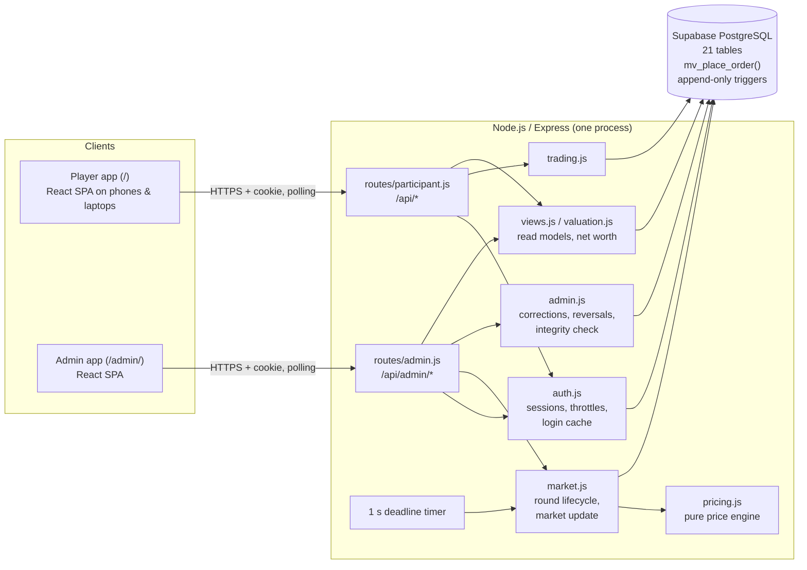

# Q-FIS MarketVerse

A live, newspaper-driven stock market game for a classroom or club event: **~50 teams of 5 (≈250
students), 20 fictional companies, 10 rounds**. Teams read a satirical newspaper, spot the real
clues among the jokes, and trade on their phones or laptops. Organisers run the market from an admin
console. Prices follow a pre-decided plan plus the teams' own buying and selling pressure.

| URL | Who | What |
|---|---|---|
| `/` | Teams (phones and laptops) | Dashboard, Trading, Markets, full order and transaction history |
| `/admin/` | Organisers | Round control, price plan, teams, orders, ledger, companies, corrections, audit log |

The big-screen presentation (newspaper slides, news videos, results) runs from a separate PowerPoint.
Newspapers go out to teams on WhatsApp, not through the portal.

---

## Contents

1. [Tech stack](#tech-stack)
2. [Architecture](#architecture)
3. [Repository layout](#repository-layout)
4. [Game rules](#game-rules)
5. [How prices move](#how-prices-move)
6. [Running it locally](#running-it-locally)
7. [Player guide](#player-guide)
8. [Admin guide](#admin-guide)
9. [Configuring a game](#configuring-a-game)
10. [Deployment](#deployment)
11. [Event-day runbook](#event-day-runbook)
12. [Testing](#testing)
13. [Security model](#security-model)
14. [Troubleshooting](#troubleshooting)

---

## Tech stack

| Layer | Choice | Why |
|---|---|---|
| Server | **Node.js ≥ 20, Express 4** | One small monolith. Its only runtime dependencies are `express` and `pg`. |
| Database | **Supabase** (hosted PostgreSQL), the only database: production, development and tests | All game state, money and guarantees live here: constraints, row locks, append-only triggers. See [`docs/SUPABASE.md`](docs/SUPABASE.md). |
| Order execution | **PL/pgSQL** (`mv_place_order`) | Each order is checked and executed in one database round trip, under a row lock. |
| Frontend | **React 18, TypeScript 5, Vite 5, Tailwind CSS 3**, lucide-react icons | Two single-page apps (player and admin) built from one codebase. |
| Auth | Session cookies (HttpOnly, SameSite), **scrypt** password hashing | No third-party auth; works on a closed event network. |
| Packaging | **Docker** (multi-stage), Docker Compose, **Caddy** for automatic HTTPS | One `docker compose up` on any VPS. Also runs on Railway or Render. |
| Tests | `node:test` integration tests, plus purpose-built load, stress, chaos and headless-browser suites | Everything runs against a real Supabase database (a separate test project). |

Money is **integer paise** everywhere and percentages are **integer basis points** (100 bps = 1%),
so rounding errors are impossible.

---

## Architecture



**Request flow**
- **Reads:** the apps poll. Players fetch market status every 2 s, prices and portfolio every 5 s,
  and history every 10 s. The admin app fetches its overview every 3 s. There are no websockets, so
  flaky Wi-Fi only delays the next poll, and nothing needs reconnecting.
- **Orders:** the player app creates an *idempotency key* each time a team opens the confirm dialog.
  `trading.js` passes the order to `mv_place_order()`, which in one transaction:
  1. locks the team row;
  2. checks the round is open, the deadline, pause, team active, cash, holdings, inventory and limits;
  3. writes the order, trade, holdings and ledger rows.

  A retried request with the same key returns the original result, so a double tap or a network
  retry can never execute twice.
- **Deadlines:** a 1-second timer closes rounds whose deadline has passed. Orders also check the
  deadline themselves, so a late tick can never let a late order through. The countdown on screens
  follows the server clock.
- **Market update:** after a round closes, the organiser previews and then applies the new prices.
  `pricing.js` is pure and deterministic: the preview is exactly what gets applied, and applying twice is impossible.
- **Audit:**
  - every admin write records who did it, why, and the before/after state in `admin_audit_log`;
  - trades, ledger entries, prices and the audit log are **append-only**, enforced by database triggers;
  - corrections are new entries (reversals, adjustments), never edits.

**Why a single instance**
- Login throttling, the per-team order throttle, the remembered-password cache and the short
  session cache live in memory.
- Every correctness guarantee is in PostgreSQL, so several instances would still keep the books
  right, but throttles would multiply.
- One instance handled 150 laptops on 0.6 of a CPU in testing.
- Deploy with **exactly one replica**.

**Data model**

| Area | Tables |
|---|---|
| Game | `game_state`, `rounds`, `companies`, `stock_prices`, `scheduled_events` (the price plan), `news_items` |
| Teams and auth | `teams`, `admins`, `sessions` |
| Books | `orders`, `trades`, `holdings`, `ledger_entries`, `order_reversals`, `loans`, `collateral`, `quest_awards` |
| Results | `leaderboard_snapshots`, `final_rankings` |
| Logs | `admin_audit_log`, `system_log` |

The full endpoint reference is in [`docs/API.md`](docs/API.md).

---

## Repository layout

```
src/
  server.js            app wiring, security headers, static files, deadline timer
  schema.sql           tables, constraints, append-only triggers, mv_place_order()
  db.js                connection pools (separate priority pool for admin actions and the timer)
  auth.js              logins, sessions, throttles, remembered-password cache
  passwords.js         scrypt hashing with a concurrency cap (logins never starve trading)
  trading.js           order entry point
  market.js            round lifecycle, market update, undo, final settlement
  pricing.js           pure, deterministic price engine
  valuation.js         net worth, rankings, leaderboard snapshots
  views.js             read models for the two apps (never exposes future events)
  admin.js             corrections, order reversal, rewards, company edits, disable team, integrity check
  loans.js             Margin Bank (off by default)
  seed.js, settings.js config validation and database seeding
  routes/              participant.js (/api/*) and admin.js (/api/admin/*)
frontend/              React + TypeScript source of both apps
  src/player/          player app: Login, Dashboard, Trading, Markets, OrderConfirm, History
  src/admin/           admin app: Overview, Rounds, Participants, Orders, Transactions, Companies
  src/shared/          API client, types, formatting, polling hooks, UI primitives
  scripts/check-no-mock.mjs   build fails if demo data, alert() stubs or Math.random creep back
public/
  app/                 built apps (generated by the frontend build; not committed)
  participant/, admin/ old plain-JS screens, served only with LEGACY_UI=1 as an emergency fallback
scripts/
  seed.js              create the database contents from config/game.json, write team passwords
  import-moves.js      spreadsheet → price script
  import-profiles.js   company profiles spreadsheet → names, CEOs, descriptions, prices
  preflight.js         read-only readiness check of a deployment
  backup.sh, restore.sh   verified dump / restore (Supabase or local); lib/pg.sh runs the pg tools in Docker
  loadtest.js, laptops.js, stress.js, ui-audit.js   test suites (see Testing)
config/
  game.sample.json     a complete example game (committed)
  game.json            THE REAL EVENT CONFIG: secret, git-ignored, never in the Docker image
test/                  integration tests; fixtures/game.json is a safe stand-in for config/game.json
docs/
  API.md               every endpoint, request and response
  RULES.md             the rules sheet to hand to teams
  DEPLOY_ORACLE.md     step-by-step Oracle Cloud deployment
  SUPABASE.md          the Supabase database: setup, connection, backups, moving a game
  FRONTEND_INTEGRATION.md   how the Monopoly frontend was connected (historical)
deploy/oracle/         deploy.sh, seed.sh, backup.sh (run from the laptop), server-setup.sh (run on the server)
papers/, media/        event material mounted at run time (contents git-ignored)
```

---

## Game rules

The team-facing version, ready to share, is [`docs/RULES.md`](docs/RULES.md). In short:

- **Start:** every team starts with **₹1,00,00,000** of virtual cash and no shares. All five members
  share one team portfolio; any member can trade, and each trade records who placed it.
- **Each round:**
  1. The newspaper goes out on WhatsApp.
  2. **Trading is open for 5 minutes** (configurable per round).
  3. Trading closes and the news segment plays.
  4. The organisers apply the new prices.
- **Orders:**
  - market buy or sell of whole shares, executed **instantly and in full** at the round's official
    price, or rejected with a reason;
  - prices don't move during a round, so being first gives no price advantage;
  - the only first-come-first-served resource is each company's limited **shares on the exchange**.
- **Fee:** 0.10% of order value on buys and sells. No short selling, no fractions, no limit orders.
  Each company has a **maximum order size**.
- **Winner:** highest **net worth** after Round 10. Net worth = cash + shares × official price −
  loan principal − interest owed.
- **Tie-breakers:** lower debt, then more cash, then higher realised profit.
- **Rankings are hidden from teams.** Organisers see live rankings and announce results themselves.
- **Corrections:**
  - a genuine fat-finger mistake reported **during the round** can be reversed exactly, fee included,
    if the team still holds those shares or that cash;
  - every correction shows in the team's history with the reason.
- **Rewards:** quizzes and quests can pay a capped cash reward (₹2,00,000 max), once per team per quest.
- **Margin Bank** (borrow against pledged shares): built and tested, but **off** in the event config.

---

## How prices move

After trading closes, each company's price is updated once:

```
new price = previous price × (1 + scripted move + trading pressure + noise)
```

- **Scripted move:** the pre-decided % for that company and round, imported from the organisers'
  spreadsheet. It encodes the newspaper clues, including clues that pay off rounds later.
- **Trading pressure:**
  - net shares bought minus sold this round, divided by the company's pressure reference, × 3%;
  - capped at **±8%**;
  - heavy buying pushes the price up, heavy selling pushes it down;
  - it is the only way teams influence prices.
- **Noise:** a deterministic ±bps term. It is **0** in the event config, so the spreadsheet is
  followed exactly when nobody trades.
- **Limits:**
  - the total move is clamped to ±60% per round;
  - the price is clamped to ₹1 – ₹1,00,000;
  - prices are rounded to the paisa.

The admin *Rounds* page shows this breakdown live, company by company, before anything is applied.

---

## Running it locally

**Prerequisites:** Node.js 20+, a Supabase project ([`docs/SUPABASE.md`](docs/SUPABASE.md)), and Docker (only for backups and deployment).

```sh
git clone <this repo> marketverse && cd marketverse
npm install
(cd frontend && npm install && npm run build)    # builds both apps into public/app

cp .env.example .env                             # then set DATABASE_URL to the Supabase URI

cp config/game.sample.json config/game.json      # or put the real event config here
ADMIN_PASSWORD='choose-a-strong-one' npm run seed -- --reset
npm start                                        # http://localhost:3000
```

- **Logins:** `npm run seed` writes the team logins to `credentials.csv`: 50 teams, random
  passwords, and the only copy. Admin username is `admin`, with the `ADMIN_PASSWORD` you chose.
- **Fixed passwords for practice:** add `--test-passwords` to the seed, so team `team01` has password
  `pw-team01`. **Never for the real event.**
- **Database:** `npm start`, the seed, preflight and backups all read `DATABASE_URL` from `.env`.
  Use a separate Supabase project for development if the event project already holds a real game.
- **Hot reload while editing screens:** run the server, then
  `cd frontend && BACKEND=http://localhost:3000 npm run dev`. Vite proxies `/api`.

**Environment variables**

| Variable | Default | Meaning |
|---|---|---|
| `DATABASE_URL` | **required** | The Supabase session pooler URI. Also read from `.env` |
| `TEST_DATABASE_URL` | — | A separate Supabase project for `npm test` (the tests wipe it). Also read from `.env` |
| `DB_SSL` | on for Supabase | `require` (encrypted), `verify` (also check the certificate against `DB_SSL_CA`, default `config/supabase-ca.crt`), `0` (off) |
| `PORT` | `3000` | HTTP port |
| `ADMIN_PASSWORD` / `ADMIN_USERNAME` | — / `admin` | Admin login created by the seed |
| `COOKIE_SECURE` | off | Set `1` when served over HTTPS |
| `DB_POOL_SIZE` | `20` | Connections for player traffic (use 40 if the DB is >10 ms away) |
| `DB_ADMIN_POOL_SIZE` | `4` | Connections reserved for admin actions and the deadline timer |
| `SCRYPT_CONCURRENCY` | `2` | Concurrent password checks |
| `DB_STARTUP_TIMEOUTS` | `session` on Supabase, else `1` | How statement/lock time limits are applied: `1` startup parameters, `session` SET on each connection, `0` not at all (set them on the role) |
| `LEGACY_UI` | off | `1` serves the old plain-JS screens instead of the React apps |

---

## Player guide

**Logging in**
1. Open the site on any phone or laptop.
2. Enter the **Team ID** (e.g. `team07`; capitals and spaces don't matter), the team **password**
   from the printed slip, and **your own name**. The name is shown next to every order you place.
3. All five members can be logged in at once, on any devices.

**Dashboard**
- **Net Worth**, **Available Cash**, **Holdings Value** and **Total Profit / Loss**, updating live.
- **Market Status:** which round, open / closed / paused, and a countdown to the deadline (server time).
- **From Organisers:** announcements typed by the organisers appear here within seconds.
- **Your Holdings:** shares, current price, position value and gain/loss per company.
- **Recent Activity:** the latest orders and cash movements.
  **View All Orders** / **View All Transactions** open the full history.

**Trading**
1. Pick a company from the list. The panel shows its price, sector, CEO, description, other
   executives, market cap, and the shares still available on the exchange.
2. Choose **Buy** or **Sell**, type a quantity (or tap **Max**), and check the estimated order value and fee.
3. Tap **Review Order**, then **Place Order** in the confirm dialog.
4. Wait for **Executed ✓**, or a clear rejection reason. Common reasons:
   - not enough cash or shares;
   - above the max order size;
   - sold out on the exchange;
   - round closed;
   - trading paused;
   - company suspended.

Tapping Place Order several times places **one** order. If the Wi-Fi drops, the app retries safely.
If it still can't tell whether the order went through, it says so: check History before trying again.

**Markets:** every company's price and change since the last round, sector and CEO.
Suspended companies are marked.

**Banners:**
- **Connection lost:** the app keeps the last data on screen and recovers on its own.
- **Trading paused:** orders are refused until the organisers resume.

---

## Admin guide

Open `/admin/` and log in with the admin username and password. Every action that changes anything
opens a dialog that says exactly what will happen, asks for a **reason** where it matters, and shows
the server's own error if it is refused. Every action is written to the audit log.

### Overview: the control room
- **Next step:** a single button that always shows what to do next:
  Start event → Open Round N → Review & apply prices → … → End event.
- **Round Control:** **Close Market** early, **Extend Round** (+ seconds, reason required), **Pause /
  Resume** all trading. On resume you choose whether the paused time is added to the deadline
  (recommended, and the same for every team).
- **Quick Announcement:** type a message to show it on every team's dashboard; **Clear** removes it.
- **KPIs:** teams, devices logged in, orders and value traded this round, disabled teams.
- **Top Participants:** live net worth. Teams never see this.
- **Recent Activity:** the latest audit-log entries.
- **System health:** database latency, connections, server errors. **Check books** runs a full integrity
  check: cash, holdings, ledger and inventory all reconcile.

### Rounds
- Pick a round. Its lifecycle buttons are **Open**, **Close Market**, **Extend**, **Reopen trading** (for an
  accidental close; only before prices are applied), **Apply Market Update** and **Undo market update**
  (only before the next round opens).
- **Price plan:**
  - for every company, the price table shows the scripted move, the live trading pressure and the
    resulting new price, before you apply anything;
  - script values for rounds not yet applied can be edited (reason required, audited);
  - if a wrong number is noticed after applying: **Undo**, fix, **Save Changes**, apply again.
- **View Round Summary:** top gainers and losers, most traded, top 5 teams. Useful for the slides.
- **Round History:** every admin action taken on that round.

### Participants
- Search and page through all teams: status, members (names typed at login), net worth, orders.
- Open a team to see its holdings, orders, ledger and net-worth history. Actions:
  - **Adjust Cash** / **Adjust Holdings:** corrections with a reason; they create ledger and audit entries.
  - **Reward:** pay a capped quiz or quest reward to one or many teams; each team is paid at most once per quest.
  - **Reverse an Order:** see Orders.
  - **Reset Password:** shows the new password once and logs out that team's devices.
  - **Disable Team:**
    - logs out all the team's devices immediately and blocks login and trading;
    - removes the team from rankings;
    - **Enable Team** restores it exactly as it was.

### Orders
- Every order across all teams, filterable by round, team, side and status. **Export CSV**.
- **Likely double taps:** lists suspicious identical orders placed seconds apart.
- **Reverse Order:**
  - undoes a trade exactly: shares, cash including the fee, realised profit, and its effect on
    that round's trading pressure;
  - the team sees "Reversed by the organisers: <reason>";
  - the server refuses, with a reason, if the team has since sold those shares or spent that cash.

### Transactions
- The full ledger: every buy, sell, fee, reward, adjustment and reversal, filterable by team, type
  and round. Totals per filter, **Export CSV**, and a **Net Worth History** chart per team.

### Companies
- Each company's price, shares on the exchange, shares held by teams, and status.
- **Edit:**
  - name, sector, description, CEO and extra details (e.g. CFO), and max shares per order;
  - during the event only the description, CEO, details and order limit can change, with a reason.
- **Suspend / Open** a company: teams see the reason, and orders in it are refused.

---

## Configuring a game

Everything lives in **`config/game.json`**. It is **secret** because it contains the future price
script. It is git-ignored and never baked into the Docker image. Start from `config/game.sample.json`.

| Section | Contents |
|---|---|
| `settings` | Starting cash, fee, pressure scale and cap, noise, price limits, max reward, `players_see_leaderboard` (false), Margin Bank (`loans.enabled`), company sizing defaults |
| `teams` | Count, display-name prefix, login-ID prefix |
| `companies` | Ticker, name, CEO, sector, starting price (₹), shares outstanding, description, `details` (e.g. `{"CFO": "…"}`); exchange float and max order size are derived from `settings.sizing` unless given |
| `rounds` | Title and trading duration in seconds for each round |
| `price_script` | The pre-decided move per company per round, in bps |
| `events` | Optional extra news events by sector or company (a company entry replaces its sector entry) |

**Importing from the organisers' spreadsheets**

```sh
# company names, CEOs, descriptions, starting prices, shares outstanding
node scripts/import-profiles.js "Monopoly Company Profiles.xlsx"            # dry run: shows every change
node scripts/import-profiles.js "Monopoly Company Profiles.xlsx" --write

# price script: a sheet with a Ticker column and Round 1 … Round 10 columns
node scripts/import-moves.js "Monopoly Market Simulation.xlsx" --sheet "Table 1"          # check only
node scripts/import-moves.js "Monopoly Market Simulation.xlsx" --sheet "Table 1" --write
```

`import-moves` prints the compounded total per company and warns if the sheet's own Total column
*adds* the moves (moves compound: −10% then +10% is −1%, not 0). Then re-seed with `npm run seed -- --reset`.
The seed validates everything and refuses to wipe a started event unless you pass `--force`.

---

## Deployment

The app needs a **long-running Node process and the Supabase database**
([`docs/SUPABASE.md`](docs/SUPABASE.md): create the project and get `DATABASE_URL` first). Static or serverless hosts (Netlify,
Vercel functions) can't run it: the deadline timer, the in-memory throttles and the database pool need
a persistent process.

### Option A: Oracle Cloud Always Free (free, scripted)
A free 2–4 CPU ARM server in Mumbai or Hyderabad. The full click-by-click guide is
[`docs/DEPLOY_ORACLE.md`](docs/DEPLOY_ORACLE.md). After the one-time console setup, everything runs from the laptop:
```sh
deploy/oracle/deploy.sh ubuntu@<IP> --database-url '<Supabase URI>'   # set up the server, copy code + config, HTTPS, start
deploy/oracle/seed.sh ubuntu@<IP> --practice        # or --real (writes ./credentials.csv)
deploy/oracle/backup.sh ubuntu@<IP> pre-event       # verified dump, copied to ./backups/
```

### Option B: Railway (paid Hobby plan)
1. Create a project in **Southeast Asia (Singapore)** with a service from this repo; the Dockerfile
   builds both apps. No database service: the database is Supabase.
2. Variables on the app service:
   - `DATABASE_URL` = the Supabase session pooler URI;
   - `COOKIE_SECURE=1`;
   - `ADMIN_PASSWORD` = a long random string;
   - `DB_POOL_SIZE=20`.
3. Replicas: exactly **1**. Give the app at least 1 vCPU (50 simultaneous first logins are CPU-heavy).
4. Seed **from your laptop** using the database's *public* URL. The server never reads `config/game.json`:
   ```sh
   DATABASE_URL='<Supabase URI>' ADMIN_PASSWORD='<same as above>' node scripts/seed.js --reset --force --out credentials.csv
   ```
5. Check: `https://<app>/api/health` returns `{"ok":true}`. Run
   `DATABASE_URL='<Supabase URI>' npm run preflight`. It must say READY.

### Option C: any other VPS with Docker Compose and Caddy (tested on 1 vCPU / 1 GB)
1. Ubuntu VPS with Docker; ports 80/443 open; a DNS A record pointing at it.
2. Copy the repo, then `cp .env.example .env` and fill in `DOMAIN`, `DATABASE_URL` and `ADMIN_PASSWORD`.
3. Put `config/game.json` in `config/`. It is mounted read-only, never inside the image.
4. `docker compose up -d --build`. `.env` selects `docker-compose.prod.yml`: app +
   Caddy with automatic HTTPS.
5. Seed: `docker compose exec -T app node scripts/seed.js --reset --force --out - > credentials.csv`.
6. Check: `docker compose exec app node scripts/preflight.js` must say READY.

**Notes**
- **Database latency:** keep app and database in the same region (Supabase `ap-south-1` Mumbai for an Indian server). Above ~10 ms of database
  round-trip time, set `DB_POOL_SIZE=40`.
- **Connections:** the app opens up to `DB_POOL_SIZE + DB_ADMIN_POOL_SIZE` (24) connections. Supabase's
  session pooler *Pool Size* must allow them (34+); preflight checks.
- **Poolers:** use Supabase's session pooler or a direct connection, not a transaction-mode pooler
  (port 6543). If you must use one, set `DB_STARTUP_TIMEOUTS=0` and set the timeouts on the role instead:
  ```sql
  ALTER ROLE ... SET statement_timeout = '15s';
  ```
- **Proxies:** proxy timeouts must exceed 15 s.
- **Backups:** `sh scripts/backup.sh <label>` dumps the database (Supabase when `DATABASE_URL` is set)
  and proves the dump restores. `sh scripts/restore.sh backups/<file>.dump` restores it. Only Docker is needed.

---

## Event-day runbook

**Before doors open**
1. Final seed with real random passwords; print one slip per team from `credentials.csv`.
2. `npm run preflight` shows no FAIL. On the admin app:
   - *Companies:* no missing CEO, no placeholder text;
   - *Rounds:* each round's price plan checked;
   - **Check books** passes.
3. `sh scripts/backup.sh pre-event`.
4. Big screen shows the PPT, **never** the admin page.
5. *Overview* → **Start event**.

**Each round** (*Overview* always shows the next step)
1. Send the newspaper on WhatsApp → **Open Round N**. The round closes automatically at the deadline.
2. *Rounds* → check the price table (script + pressure) → **Apply Market Update**. New prices
   appear on every screen. **View Round Summary** gives you the numbers for the slides.
3. Optional: `sh scripts/backup.sh after-rN`.

After Round 10: **End event** freezes the final rankings.

**Emergencies**

| Situation | Action |
|---|---|
| Anything going wrong mid-round | **Pause** trading; **Resume** with the paused time added to the deadline |
| Need more time | **Extend Round** |
| Closed too early | **Reopen trading** (before applying prices) |
| Wrong price applied | **Undo market update** → fix the script value → apply again (before the next round opens) |
| A team's fat-finger trade | *Orders* → **Reverse** |
| Leaked password / cheating | **Reset Password** or **Disable Team** |
| Something wrong with a company | *Companies* → **Suspend** (reason shown to teams) |
| Portal down | Pause if possible; the database keeps every committed trade. Restart the app (state lives entirely in the database); resume with the pause added. Last resort: `scripts/restore.sh` the latest backup. |

---

## Testing

```sh
# TEST_DATABASE_URL (environment or .env) = a separate Supabase project kept for tests: they wipe it.
# The tests refuse to run if it is the game's DATABASE_URL.
npm test
```

In a fresh clone the tests run on `test/fixtures/game.json`: the real companies with a made-up
price script. With the secret `config/game.json` present, they also verify the real script.

| Suite | Command | What it proves |
|---|---|---|
| Integration tests (30) | `npm test` | Order maths, fees and every rejection rule. Idempotency under concurrent identical submits. No overselling under races. Server-side deadline, pause, preview = apply, append-only enforcement, corrections and reversals. A full 50-team, 10-round game replayed independently to the paisa. No endpoint leaks hidden data. |
| Load test | `npm run loadtest` | 250 sessions; ~10% of orders double-submitted; deadline bursts. Result: 0 errors, 0 duplicate executions. |
| 50-laptop suite | `npm run laptops` | Waves of simultaneous logins, 150 devices, Wi-Fi drops, refresh storms, a 60 s soak. |
| Stress / edge cases (94 checks) | `npm run stress` | Hostile input, races between teammates, spam throttling, admin double-clicks under load, pause mid-flood, the real deadline, disabling a team mid-flood, hostile admin queries. |
| Browser audit (138 checks) | `node scripts/ui-audit.js` | A real headless browser drives both apps through a whole event, presses every button, and verifies each result through the API. Edge cases: triple-tapped confirm, Wi-Fi lost during confirm, XSS attempts, vanished sessions. |

All of the suites except `npm test` **destroy game state** on their target. Run them on a practice
deployment seeded with `--test-passwords`, then re-seed for real. Example:

```sh
ADMIN_PASSWORD=x npm run seed -- --reset --force --test-passwords
npm start &
ADMIN_PASSWORD=x npm run stress -- --url http://localhost:3000
```

The stress suite expects short rounds, so the deadline really expires during the test. Seed it from
a config copy whose rounds last ~20 s, with loans enabled:

```sh
node -e 'const c=require("./config/game.json");c.rounds.forEach(r=>r.duration_seconds=20);c.settings.loans.enabled=true;require("fs").writeFileSync("/tmp/stress.json",JSON.stringify(c))'
ADMIN_PASSWORD=x npm run seed -- --reset --force --test-passwords --config /tmp/stress.json
```

**Last full run:**
- every suite passed on a laptop and on a production-like stack (1 vCPU, 1 GB, HTTPS);
- chaos tests (`kill -9` of the app and a PostgreSQL restart during ~3,700 orders) lost 0 orders and doubled 0.

---

## Security model

- **Separate logins:** team and admin sessions are separate. Every `/api/admin/*` route requires an
  admin session.
- **Cookies:** HttpOnly and SameSite, and `Secure` with `COOKIE_SECURE=1`.
- **Login throttling:** throttled per ID with a deliberately high threshold, because a whole hall
  shares one NAT address. A rival guessing passwords can't lock out the real team, and organisers are alerted.
- **Nothing secret reaches players:** future events, the price script, other teams' data and rankings
  are never sent to a team. `config/game.json` is never web-accessible.
- **Validated input:** all input is validated server-side, and the frontend renders all text as text,
  so CEO names or messages containing HTML never run.
- **Headers:** `X-Frame-Options: DENY`, `nosniff`, `Referrer-Policy: same-origin`, and `no-store`
  on API responses.
- **Append-only books:** enforced by database triggers. Every admin write is audited with the reason
  and before/after state.
- **Supabase's public API is shut:** at startup the app turns on row level security and revokes the
  `anon`/`authenticated` roles' access to every game table and function, so the project's public anon
  key can't read password hashes or place orders. Preflight checks it. The app connects over SSL.

---

## Troubleshooting

| Symptom | Fix |
|---|---|
| `DATABASE_URL is not set` | Put the Supabase URI in `.env` ([`docs/SUPABASE.md`](docs/SUPABASE.md)) |
| Supabase: `ENOTFOUND` / `ENETUNREACH` on `db.<ref>.supabase.co` | That host is IPv6-only: use the **Session pooler** URI ([`docs/SUPABASE.md`](docs/SUPABASE.md)) |
| Supabase: `password authentication failed` | User must be `postgres.<project-ref>` on the pooler; special characters in the password must be percent-encoded |
| Supabase: `max clients reached` / preflight can't open all connections | Raise *Pool Size* in Supabase's Database settings to 34+ |
| Supabase: project paused | Dashboard → Restore project (free projects pause after a week idle) |
| Blank page or old screens at `/` | Build the apps: `cd frontend && npm install && npm run build` |
| `npm test` fails to connect | Create the test DB (see Testing) |
| Seed refuses: "event has started" | Add `--force` (wipes the game) |
| Logins slow on a tiny server | Expected for the very first login of each team (scrypt). Later logins by teammates are cached. Give the app ≥ 1 vCPU. |
| Preflight FAIL "test passwords" | Re-seed without `--test-passwords` |
